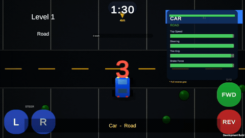
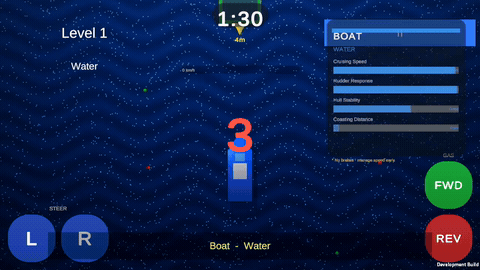
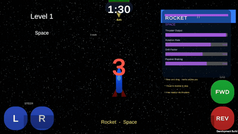

# Parking Mayhem

A cross-platform (Android / iOS) arcade **parking puzzle** built in Unity. Park your
vehicle in the glowing zone across four terrains — **Road, Water, Air, Space** — each with
its own handling model (grip, drift, wind, inertia), procedurally generated art and audio,
moving hazards, parallel-parking and berth challenges, a coin economy, skins, and
achievements. All art and sound are generated at runtime (no external asset packs).

> Package id: `com.parkingrush.vmullapudiapps` · Engine: **Unity 6000.4.11f1**

## Gameplay

Each terrain has its own vehicle and handling model, shown in the level-intro stats card, with a
live on-screen arrow + distance guiding you to the parking spot.

| Road | Water | Space |
|:----:|:-----:|:-----:|
|  |  |  |
| Car · grip & braking | Boat · drift & coasting | Rocket · inertia & thrusters |

---

## Requirements

| Tool | Version |
|------|---------|
| **Unity** | `6000.4.11f1` (install via Unity Hub) |
| Unity modules | **Android Build Support** (+ OpenJDK, SDK & NDK) and, for iOS, **iOS Build Support** |
| Android SDK | Platform **API 36** installed (target SDK), min SDK 25 |
| For device testing | Android `platform-tools` (adb) on your `PATH` |
| OS for iOS builds | macOS with Xcode |

---

## Getting started (open & play in the Editor)

```bash
git clone git@github.com:venkymullapudi/ParkingMayhem.git
cd ParkingMayhem
```

1. Open **Unity Hub → Add → select this folder**. Hub will prompt to install editor
   `6000.4.11f1` if you don't have it.
2. Open the project, then open the scene **`Assets/Scenes/MainMenu.unity`**.
3. Press **Play**. Use the on-screen controls (or arrow keys in the editor) to drive; come to
   a full stop inside the parking zone to clear the level.

The first scene is `MainMenu`; it loads `Game.unity` when you tap **PLAY** and pick a terrain.

---

## Building

Build helpers live in [`Assets/Editor/BuildScript.cs`](Assets/Editor/BuildScript.cs) and are
exposed under the **`ParkingRush`** menu in the editor, or runnable headless from the CLI.

### Signing setup (one-time, required for release AAB)

The release keystore and its password are **intentionally NOT in this repo** (secrets). To
build a signed release you need both of these in the project root (same folder as this README):

- `parking-rush-release.keystore` — the upload/signing keystore
- `parking-rush-keystore.pass` — a one-line text file containing the keystore password

`BuildScript.SetupAndroidKeystore()` reads the password from that gitignored `.pass` file (or
from the `ANDROID_KEYSTORE_PATH` / `ANDROID_KEYSTORE_PASS` / `ANDROID_KEY_ALIAS` /
`ANDROID_KEY_PASS` environment variables if you prefer). Without them, builds fall back to
Unity's debug keystore (fine for local testing, not for Play Store upload).

### Debug APK (local testing)

```bash
/Applications/Unity/Hub/Editor/6000.4.11f1/Unity.app/Contents/MacOS/Unity \
  -batchmode -nographics -projectPath "$(pwd)" \
  -executeMethod BuildScript.BuildAPK -logFile build.log -quit
```
Output: `Builds/Android/ParkingRush-debug.apk`

### Signed AAB (Google Play)

```bash
/Applications/Unity/Hub/Editor/6000.4.11f1/Unity.app/Contents/MacOS/Unity \
  -batchmode -nographics -projectPath "$(pwd)" \
  -executeMethod BuildScript.BuildAndroidCI -logFile build.log -quit
```
Output: `Builds/Android/ParkingRush.aab` (auto-increments versionCode, targets **API 36**) plus
a matching `ParkingRush-<ver>-vN-IL2CPP.symbols.zip` of native debug symbols. Upload **both**
to the Play Console — the AAB, and the symbols zip under the release's native-symbols section.

### iOS (Xcode project)

```bash
/Applications/Unity/Hub/Editor/6000.4.11f1/Unity.app/Contents/MacOS/Unity \
  -batchmode -nographics -projectPath "$(pwd)" \
  -executeMethod BuildScript.BuildIOS -logFile build.log -quit
```
Produces an Xcode project under `Builds/iOS/` — open it in Xcode to sign and run on a device.
(iOS Simulator is not supported here: Unity ships an x86_64-only simulator slice that won't run
on Apple-Silicon iOS simulators, so iOS testing is device-only.)

---

## Run on an Android emulator / device

```bash
# install to a connected device or running emulator
adb install -r Builds/Android/ParkingRush-debug.apk
adb shell monkey -p com.parkingrush.vmullapudiapps -c android.intent.category.LAUNCHER 1
```
The game is landscape-locked; set the emulator to landscape if needed
(`adb shell settings put system user_rotation 1`).

---

## Project layout

```
Assets/
├── Editor/        BuildScript.cs (build menu + CLI), SceneSetup, AndroidManifestPostProcess
├── Scenes/        MainMenu.unity, Game.unity
├── Scripts/       Gameplay — GameManager, VehicleController, ParkingZone, Obstacle,
│                  ScoreManager, LevelData, AudioManager, ProceduralAudio, SpriteGenerator,
│                  CameraFollow, MainMenuManager, UI/ (GameHUD, OnScreenControls, ParticleCanvas)
├── Shaders/       Custom shaders / shadergraph
└── Scenes/ etc.
ProjectSettings/   Unity project configuration (committed)
Packages/          Package manifest (committed)
```

Not committed (see `.gitignore`): `Library/`, `Builds/`, `Logs/`, `UserSettings/`, build logs,
APK/AAB artifacts, and all signing secrets.

---

## Notes

- **Procedural everything** — vehicles, zones, hazards, backgrounds, and all audio are generated
  at runtime in `SpriteGenerator.cs` / `ProceduralAudio.cs`, so the repo carries no large art.
- **Device support** — `AndroidManifestPostProcess.cs` marks landscape/portrait/touchscreen/vulkan
  as `required="false"` so the app isn't filtered off most of the Play device catalog.
- Rendering uses **Linear** color space; runtime-generated textures convert gamma→linear.
